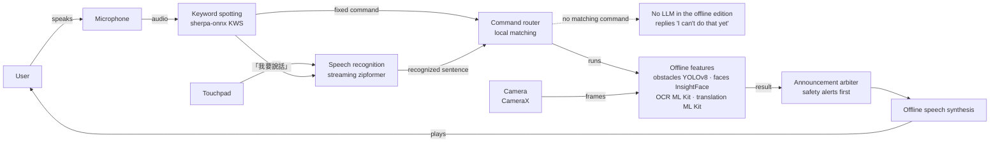
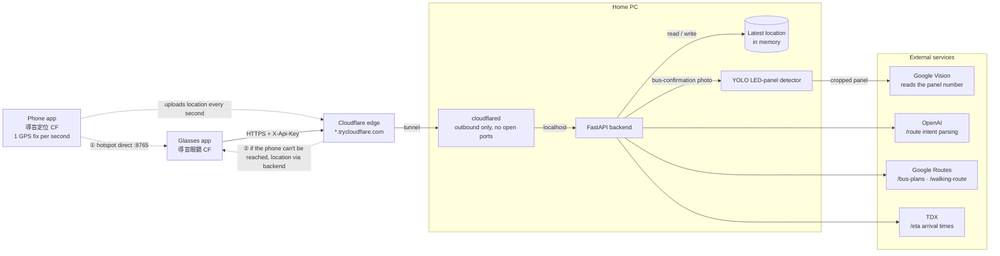
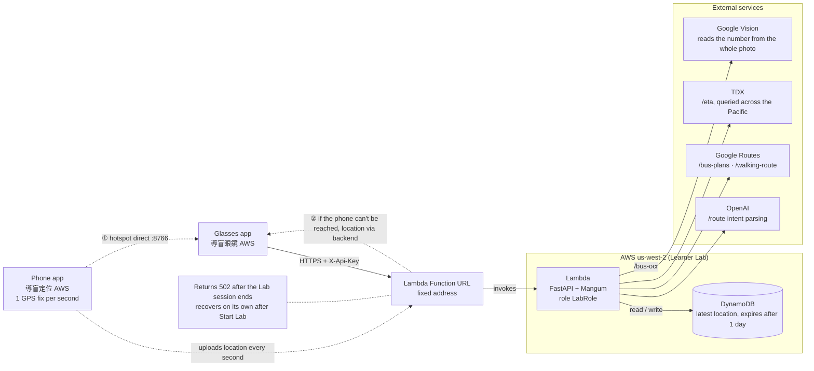
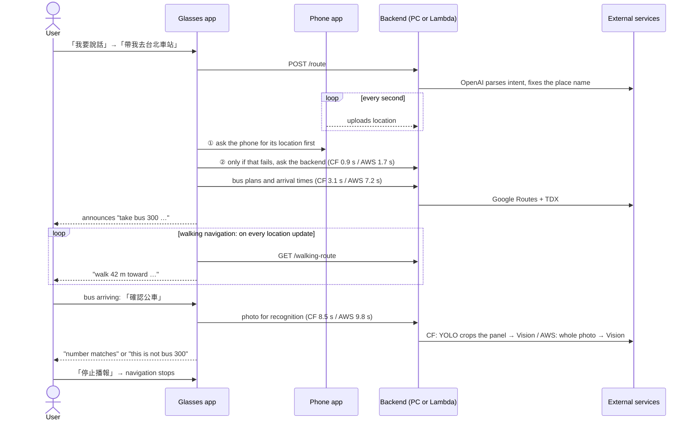

# Guide Glasses — AI Navigation Glasses for the Visually Impaired

**English** | [繁體中文](README.zh-TW.md)

Guide Glasses turns a pair of **Rokid smart glasses** into a voice-controlled assistant for blind and low-vision users.
Wearing the glasses, the user never has to look at a screen or press a button. They just speak, and the glasses
tell them what is ahead, who is in front of them, what a sign says, and how to catch the right bus.

> The cloud makes the glasses *smarter*; the glasses keep the user *safe*.
> Obstacle detection, face recognition, text reading and speech all run **on the glasses, offline**.
> Only features that need live data or an LLM (bus routes, arrival times, free-form questions) go online.

---

## Three Editions

| Edition | Glasses app | Phone app | Backend | Must be running | Status |
|---|---|---|---|---|---|
| **Offline (edge)** | `edge/`, "導盲眼鏡" | none | none | the glasses only | Frozen, kept for reference |
| **Cloudflare** | `apps/`, "導盲眼鏡 CF" | "導盲定位 CF" | FastAPI on a home PC + Cloudflare Tunnel | the PC, backend and tunnel | **Main edition, field-tested** |
| **AWS** | `apps/`, "導盲眼鏡 AWS" | "導盲定位 AWS" | AWS Lambda + Function URL + DynamoDB | an AWS Academy Learner Lab session | **Deployed and tested on the glasses** |

- The **offline features are identical** in all three editions. They differ only in who handles the online half.
- The Cloudflare and AWS editions build their apps from **one codebase** (Gradle productFlavors) and run **one backend codebase**.
- All three can be installed on the same glasses. Whichever one you open takes over the camera and microphone; the others step aside.

## Highlights

- **Fully voice-controlled, no buttons.** 18 spoken commands, no wake word. Say *"我要說話"* (or tap the touchpad once) to ask anything in free speech.
- **Safety features work offline.** Obstacle detection (YOLOv8), face recognition, text reading (OCR), translation, speech recognition and speech synthesis all run on the glasses.
- **A complete bus trip, end to end.** Plan the fastest bus → walk to the stop with turn-by-turn voice guidance → point the glasses at the arriving bus to confirm its route number.
- **The phone is the GPS.** The glasses have no GPS. When they are on the phone's hotspot they ask the phone directly; otherwise they fetch the location the phone uploaded to the backend.
- **A natural-language assistant.** An LLM understands requests such as *"帶我去中正紀念堂"* ("take me to Chiang Kai-shek Memorial Hall"), corrects speech-recognition typos in Taiwanese place names, and asks the user to repeat anything it cannot make out.
- **Built for real devices.** Announcements are always at maximum volume and are restored if someone turns them down; the backend URL can be changed at runtime, so a restarted Cloudflare tunnel needs no rebuild.
- **Privacy and security by default.** Face embeddings stay on the glasses, encrypted with AES-GCM keys held in the Android Keystore. The backend rejects every request without an API key (fail-closed). Keys, face photos and location data are kept out of the repository.

## What It Can Do

Just speak. No wake word is needed.

| Feature | Say (Mandarin) | Meaning | Needs internet |
|---|---|---|---|
| Stop everything (including navigation) | 停止播報 / 不要說了 | "Stop" | No |
| Detect obstacles once / continuously | 前面有什麼 / 持續偵測前方 | "What's ahead?" / "Keep watching ahead" | No |
| Recognize a person | 這是誰 / 這個人是誰 / 前面有沒有人 | "Who is this?" | No |
| Read text / signs | 上面寫什麼 / 唸給我聽 / 這是哪裡 / 下一段 | "What does it say?" | No |
| Translate the text just read | 翻成英文 | "Translate to English" | No (language pack downloaded once) |
| Plan a bus trip (preset destination) | 查公車路線 | "Find a bus route" | Yes |
| Confirm the arriving bus | 確認公車 | "Confirm the bus" | Yes |
| Readiness check | 出門前檢查 | "Check before going out" | No |
| Sync registered faces | 同步人臉 | "Sync faces" | Needs the enrollment server |
| Camera self-test | 測試相機 | "Test camera" | No |
| Ask anything / name a destination | 我要說話 → *beep* → your request | "I want to talk" | Yes |

After *"我要說話"* and the beep, you can also say:

| Say (Mandarin) | What happens |
|---|---|
| 帶我去○○ ("take me to …") | The LLM extracts the destination, plans a bus there and starts navigation |
| 準備翻譯 ("prepare translation") | Downloads the English language pack so translation works offline |
| 再說一次 / 上一段 ("repeat" / "previous") | Repeats the last announcement / goes back one passage |
| 翻成日文 ("translate to Japanese") | Translates into another language |
| 測試感測器 ("test sensors") | Motion-sensor self-test |
| Any question | A short answer from the LLM |

**Example: taking a bus**

1. Say *"我要說話"*, wait for the beep, then say *"帶我去 …"* ("take me to …"). Or simply say *"查公車路線"* to go to the preset destination.
2. The glasses announce which bus to take, where to board, and when the next one arrives.
3. Turn-by-turn **walking navigation to the bus stop starts automatically**.
4. When a bus arrives, face its front and say *"確認公車"*. The glasses read the route number on the LED panel and tell you whether it matches.
5. Say *"停止播報"* to end navigation.

## System Architecture

### Offline edition: from hearing a sentence to speaking the answer, all on the glasses

This is also the glasses side of the Cloudflare and AWS editions; those two only add a path from the command router to a backend.



### Cloudflare edition: online requests travel through a tunnel back to the home PC

The home PC opens no inbound ports. `cloudflared` connects out to Cloudflare, and requests come back through the tunnel to the local FastAPI.



### AWS edition: the same backend code, run by Lambda

Only the middle differs from the Cloudflare edition: no home PC or tunnel, a fixed URL, phone location stored in DynamoDB, and no YOLO for bus confirmation.



### One bus trip: the order requests take

The Cloudflare and AWS editions follow exactly the same sequence; only the backend differs (home PC or Lambda). Times are measured from the glasses sending a request to receiving the result.



| Part | Responsibilities | Tech |
|---|---|---|
| Glasses app | Voice commands, speech recognition, on-device vision, offline speech output, navigation state machine, announcement arbitration | Kotlin, CameraX, Hilt, sherpa-onnx, ONNX Runtime, ML Kit |
| Phone app | GPS fixes every second, served directly to the glasses over the hotspot and uploaded to the backend as a fallback | Kotlin, Fused Location, foreground service |
| Backend | LLM intent parsing, bus plans and arrival times, walking routes, bus front-panel recognition, location relay | Python 3.12, FastAPI, OpenAI, Google Routes, TDX, Ultralytics YOLO, Google Cloud Vision; the AWS edition adds Mangum and DynamoDB |

## AI Models

| Task | Model | Runs on | License |
|---|---|---|---|
| Obstacle detection (8 classes: pedestrian, car, motorcycle, bicycle, obstacle, crosswalk, tactile paving, sidewalk) | `obstacle_yolov8.onnx`, **trained by our team** from YOLOv8n-seg | Glasses | AGPL-3.0 (Ultralytics) |
| Bus LED panel detection | `best.pt`, **trained by our team** with Ultralytics YOLO | Backend (Cloudflare edition only) | AGPL-3.0 (Ultralytics) |
| Face embedding (512-d) | InsightFace `w600k_mbf` (MobileFaceNet, ArcFace) | Glasses | Non-commercial research only |
| English speech synthesis | Piper `en_US-amy-medium` (VITS) | Glasses | See model card |
| Keyword spotting (voice commands) | sherpa-onnx zipformer KWS | Glasses | See sherpa-onnx |
| Speech recognition (Mandarin, streaming) | `sherpa-onnx-streaming-zipformer-small-ctc-zh-int8-2025-04-01` | Glasses | See sherpa-onnx |
| Mandarin speech synthesis | `matcha-icefall-zh-baker` + HiFi-GAN vocoder | Glasses | See sherpa-onnx |
| Face detection, OCR, translation | Google ML Kit | Glasses | Google ML Kit terms |
| Intent parsing and chat | OpenAI `gpt-4o-mini` | Cloud | OpenAI terms |
| Bus number OCR | Google Cloud Vision | Cloud | Google Cloud terms |

Model sources and SHA-256 checksums are listed in [`shared/models/README.md`](shared/models/README.md).

## Repository Structure

Grouped by edition. Items marked "(git-ignored)" exist only on your own machine; a fresh clone does not have them.

```
guide_glasses_project_/
├── README.md                          English README (GitHub home page)
├── README.zh-TW.md                    Traditional Chinese README
├── LICENSE                            MIT
├── .gitignore · .gitattributes
│
│  ══ Offline edition: glasses only, no network, no backend ══════════════
│
├── edge/                              Standalone Android project (frozen, = tag v1-local-only, kept for reference)
│   ├── app/                           Glasses app "導盲眼鏡" (com.guideglasses)
│   ├── core/                          core-domain · core-common · core-database
│   ├── ai/                            ai-asr-offline · ai-tts-offline · ai-speech · ai-agent
│   │                                  ai-vision · ai-face · ai-ocr · ai-translate
│   ├── glasses/                       glasses-camerax · glasses-sensors
│   ├── feature/feature-assistant/
│   ├── tools/
│   ├── README.md · DOCUMENTATION.md · Gradle files (gradlew.bat, settings.gradle.kts, …)
│   ├── local.properties               (git-ignored) Android SDK path
│   └── ai/ai-asr-offline/src/main/assets/kws/, zh/
│                                      (git-ignored) keyword-spotting and speech-recognition models
│
│  ══ Cloudflare + AWS editions: one shared Android codebase ═════════════
│
├── apps/
│   ├── app/                           Glasses app "導盲眼鏡 CF / AWS"
│   │   ├── src/main/kotlin/com/guideglasses/      Everything both editions share
│   │   │   ├── MainActivity.kt                    Screen with no buttons, touchpad tap, debug broadcasts
│   │   │   ├── GuideGlassesApplication.kt         Max volume on start, hand-off between editions
│   │   │   ├── GuideGlassesForegroundService.kt   Keeps camera & microphone alive in the background, holds the volume
│   │   │   ├── SensorHandoff.kt                   Lets the three editions take turns with the sensors
│   │   │   ├── AnnouncementVolume.kt              Announcement volume 15/15, restored if lowered while guiding
│   │   │   └── di/
│   │   │       ├── AssistantModule.kt             Feature wiring (preset bus destination, phone direct URL, …)
│   │   │       ├── CoreModule.kt                  Core wiring
│   │   │       ├── ApiKeyInterceptor.kt           Adds X-Api-Key to every request
│   │   │       └── BackendUrlOverride.kt          Changes the backend URL at runtime (no rebuild)
│   │   ├── src/cloudflare/            Cloudflare-only: just the icon background (orange)
│   │   ├── src/aws/                   AWS-only: just the icon background (dark blue)
│   │   └── build.gradle.kts           Where the editions differ: name, package, backend URLs, phone port
│   ├── companion/companion-app/       Phone app "導盲定位 CF / AWS" (shared by both editions)
│   │   ├── MainActivity.kt                        Permissions and backend-URL settings screen
│   │   ├── LocationReportService.kt               Foreground service: GPS every second, uploaded to the backend
│   │   ├── LocalLocationServer.kt                 Hotspot server the glasses query directly (CF 8765 / AWS 8766)
│   │   ├── LocationHttpResponder.kt               Responses of the direct server (API key required)
│   │   └── BackendUrlStore.kt                     Backend URL set on the phone, synced to the glasses
│   ├── core/
│   │   ├── core-domain/               Pure-Kotlin logic, one package per feature:
│   │   │                              assistant (voice commands, intent routing) · announce (priority)
│   │   │                              bus (planning & confirmation) · navigation (walking) · face (matching)
│   │   │                              obstacle · ocr · text · translate · readiness · speech
│   │   │                              backend · glasses · motion
│   │   ├── core-common/               Shared utilities
│   │   └── core-database/             Face database (PersonStorage) and embedding encryption (EmbeddingCipher)
│   ├── ai/
│   │   ├── ai-asr-offline/            Offline speech recognition & keyword spotting (sherpa-onnx)
│   │   ├── ai-tts-offline/            Offline speech synthesis: Mandarin matcha, English Piper (models in assets/)
│   │   ├── ai-speech/                 System speech services (fallback)
│   │   ├── ai-agent/                  LLM intent gateway (calls backend /route)
│   │   ├── ai-vision/                 Obstacle detection (team-trained obstacle_yolov8.onnx)
│   │   ├── ai-face/                   Face detection (ML Kit), embedding (InsightFace w600k_mbf), photo sync
│   │   ├── ai-ocr/                    Text recognition (ML Kit)
│   │   ├── ai-translate/              Translation (ML Kit)
│   │   └── ai-navigation/             Phone location (direct / via backend), bus & walking routes, bus OCR
│   ├── glasses/
│   │   ├── glasses-camerax/           Camera (CameraX)
│   │   └── glasses-sensors/           Motion sensors
│   ├── feature/feature-assistant/     Assistant command dispatch (AssistantViewModel) and beep tone
│   ├── tools/
│   │   ├── face_enroll_server.py      Face enrollment server: upload photos in a browser, the glasses sync them
│   │   ├── test_commands.ps1          Voice-command detection-rate test
│   │   └── README.md
│   ├── README.md · DOCUMENTATION.md · Gradle files (gradlew.bat, settings.gradle.kts, …)
│   ├── keystore.properties.example    Shared signing-key template
│   ├── keystore.properties            (git-ignored) shared signing key
│   ├── local.properties               (git-ignored) backend URLs and API keys for each edition
│   └── ai/ai-asr-offline/src/main/assets/kws/, zh/
│                                      (git-ignored) keyword-spotting and speech-recognition models
│
│  ══ Backend: one codebase for the Cloudflare and AWS editions ══════════
│
├── backend/
│   ├── app/                           FastAPI
│   │   ├── main.py                    API-key check, /route (LLM), /health, /ws (echo only for now)
│   │   ├── config.py                  Settings (paths resolved relative to backend/)
│   │   ├── llm.py                     OpenAI intent parsing, place-name correction, system prompt
│   │   ├── bus_logic.py               Bus plans, ETA, LED-panel YOLO + Cloud Vision
│   │   ├── navigation_logic.py        Walking routes
│   │   ├── lambda_handler.py          AWS edition only: Lambda entry point (Mangum)
│   │   └── routers/
│   │       ├── bus.py                 /bus-plans · /eta · /bus-ocr
│   │       ├── location.py            /update-location · /current-location (CF in memory / AWS in DynamoDB)
│   │       ├── navigation.py          /walking-route
│   │       └── translate.py           /translate · /latest-text
│   ├── tests/                         pytest (36 tests; AWS mocked locally with moto)
│   ├── deploy/
│   │   ├── cloudflare/                Cloudflare edition deployment
│   │   │   ├── start-backend.ps1      Starts the backend from .venv (listens on 127.0.0.1 only)
│   │   │   ├── config.yml.example     Named-tunnel template (for when you own a domain)
│   │   │   └── README.md
│   │   └── aws/                       AWS edition deployment
│   │       ├── build_lambda.py        Builds the Lambda package (no Docker needed)
│   │       ├── deploy.py              deploy / status / destroy
│   │       └── README.md
│   ├── requirements.txt               Cloudflare edition (includes YOLO)
│   ├── requirements-lambda.txt        AWS edition (no torch, so no YOLO)
│   ├── requirements-dev.txt           Tests and deployment tools
│   ├── .env.example                   Settings template (Cloudflare edition)
│   ├── .env.aws.example               Settings template (AWS edition)
│   ├── README.md
│   ├── .env · .env.aws                (git-ignored) keys for each edition
│   ├── credentials/                   (git-ignored) Google Cloud Vision service account
│   ├── models/                        (git-ignored) LED-panel YOLO model
│   ├── debug/                         (git-ignored) frames saved by bus confirmation
│   └── build/                         (git-ignored) AWS package lambda.zip
│
│  ══ Shared data and docs ═══════════════════════════════════════════════
│
├── shared/
│   ├── README.md
│   ├── models/                        README.md · SHA256SUMS.txt (the model files themselves are git-ignored)
│   └── faces/                         (git-ignored) face enrollment photos
├── docs/
│   ├── AI導盲眼鏡專題計畫書.pdf · AI導盲眼鏡專題心得.pdf · AI導盲眼鏡操作卡.pdf   (project plan, reflections, quick-start card)
│   ├── 目前進度與目標.pdf · 開源AI模型應用組佐證文件.docx                      (status report, competition evidence)
│   ├── ARCHITECTURE.md                Architecture
│   ├── DEVICE_FINDINGS.md             Device findings (§23: networked editions)
│   ├── PROVISIONING.md                Glasses provisioning (background restriction)
│   ├── RESTRUCTURE_NOTES.md           2026-09-29 three-edition restructure
│   ├── DEVELOPER_GUIDE.md · TECHNICAL_NOTES.md · IMPLEMENTATION_PLAN.md
│   ├── ROADMAP.md · STATUS.md · TASKS.md · PRESENTATION.md · README.md
│   ├── proposals/                     Navigation-integration proposals (on-premises and AWS Learner Lab)
│   └── archive/                       Patches and bundle of the old copilot-refactor-ai-assistant branch
└── backup/                            Pre-restructure originals, kept untouched
    ├── github-v1-local-only/          Team prototypes: AI_Assistant · Audio_Navigation · Face_Recognition
    │                                  Obstacle_Recognition · Text_Recognition
    ├── apk/                           (git-ignored) APK of the official offline edition
    ├── local-configs/                 (git-ignored) pre-restructure local settings
    └── local-faces/                   (git-ignored) face photos moved out of the team prototypes
```

Which folders each edition uses:

| | Offline | Cloudflare | AWS |
|---|---|---|---|
| Glasses app | `edge/` | `apps/`, build `cloudflareDebug` | `apps/`, build `awsDebug` |
| Phone app | none | `apps/companion/` (cloudflare) | `apps/companion/` (aws) |
| Backend code | none | `backend/app/` | `backend/app/` + `lambda_handler.py` |
| Deployment | — | `backend/deploy/cloudflare/` | `backend/deploy/aws/` |
| Keys | — | `backend/.env`, `guideglasses.cloudflare.*` | `backend/.env.aws`, `guideglasses.aws.*` |

## Getting Started

### 1. Common setup

**Requirements**

- Rokid Glasses (Android 12) and an Android phone (networked editions only)
- Windows PC with **Android Studio** (bundled JDK 17+) and Android SDK 36
- **Python 3.12**; plus **cloudflared** for the Cloudflare edition, or an **AWS Academy Learner Lab** account for the AWS edition
- API keys (networked editions): OpenAI, Google Maps Platform (Routes API), TDX, and a Google Cloud Vision service account

**Get the code**

```bash
git clone https://github.com/mato1321/guide_glasses_project_.git
cd guide_glasses_project_
```

**Speech models**: the speech recognition and keyword-spotting model files are too large for Git. See
[`shared/models/README.md`](shared/models/README.md) for where to get them and how to verify them, then place them in the
project you build: `apps/ai/ai-asr-offline/src/main/assets/` and/or `edge/ai/ai-asr-offline/src/main/assets/` (each has `kws/` and `zh/`).

**Shared signing key (optional)**: copy `apps/keystore.properties.example` to `apps/keystore.properties` so every team member
signs with the same key and can install over each other's builds without uninstalling first.

### 2. Offline edition

```bash
cd edge
gradlew.bat assembleDebug
adb -s <glasses-serial> install -r -g app/build/outputs/apk/debug/app-debug.apk
```

- `edge/local.properties` only needs `sdk.dir`.
- The offline edition is signed with your PC's own debug key. If the glasses already have a "導盲眼鏡" signed on another PC, uninstall it first (its face data is removed with it).
- Open **導盲眼鏡** on the glasses.

### 3. Cloudflare edition

**3-1. Start the backend and tunnel**

```bash
cd backend
py -3.12 -m venv .venv
.venv\Scripts\pip install -r requirements.txt
copy .env.example .env
```

Fill in `.env`, including `GUIDEGLASSES_API_KEY`, a shared secret of your choice. Without it, the backend rejects every request.
Then start the backend and open a tunnel (keep both windows open):

```bash
powershell -ExecutionPolicy Bypass -File deploy\cloudflare\start-backend.ps1 -Port 8001
```

```bash
cloudflared tunnel --url http://localhost:8001
```

Check `https://<your-tunnel>.trycloudflare.com/health`. It should return `{"status":"ok"}`.
A quick tunnel gets a new URL every time it restarts; a fixed URL needs your own domain and a named Cloudflare tunnel, see
[`backend/deploy/cloudflare/README.md`](backend/deploy/cloudflare/README.md).

**3-2. Configure and build the apps**

Create `apps/local.properties`. It is git-ignored, so keys stay on your machine.

```properties
sdk.dir=C\:\\Users\\<you>\\AppData\\Local\\Android\\Sdk
guideglasses.cloudflare.busApiEndpoint=https://<your-tunnel>.trycloudflare.com
guideglasses.cloudflare.llmEndpoint=https://<your-tunnel>.trycloudflare.com/route
guideglasses.cloudflare.apiKey=<same value as GUIDEGLASSES_API_KEY>
guideglasses.cloudflare.photoEndpoint=http://127.0.0.1:8100
```

Open the **`apps` folder** in Android Studio (choose `cloudflareDebug` under Build Variants), or build from the command line:

```bash
cd apps
gradlew.bat :app:assembleCloudflareDebug :companion:companion-app:assembleCloudflareDebug
```

**3-3. Install**

```bash
adb -s <glasses-serial> install -r -g app/build/outputs/apk/cloudflare/debug/app-cloudflare-debug.apk
adb -s <phone-serial> install -r companion/companion-app/build/outputs/apk/cloudflare/debug/companion-app-cloudflare-debug.apk
```

Xiaomi (MIUI) phones refuse `-g`: tap "Install" on the phone, then allow **precise location** and **notifications** when the app opens.
Then continue with *First-time setup* below.

### 4. AWS edition

See [`backend/deploy/aws/README.md`](backend/deploy/aws/README.md) for the full steps and costs. In short:

1. Sign in to AWS Academy → Learner Lab → **Start Lab**, and paste the AWS CLI credentials from "AWS Details" into `%USERPROFILE%\.aws\credentials` (again every session).
2. Copy `backend/.env.aws.example` to `backend/.env.aws` and fill in the keys; generate a separate `GUIDEGLASSES_API_KEY` rather than reusing the Cloudflare one.
3. Build and deploy. The deploy step runs a smoke test and prints the Function URL:
   ```bash
   .venv\Scripts\python deploy\aws\build_lambda.py
   ```
   ```bash
   .venv\Scripts\python deploy\aws\deploy.py deploy
   ```
4. Add `guideglasses.aws.busApiEndpoint`, `guideglasses.aws.llmEndpoint` (with `/route`), `guideglasses.aws.apiKey` and `guideglasses.aws.photoEndpoint` to `apps/local.properties`.
5. Build `:app:assembleAwsDebug :companion:companion-app:assembleAwsDebug` and install as for the Cloudflare edition. The apps are called "導盲眼鏡 AWS" and "導盲定位 AWS".

> After the Lab session ends, the URL returns 502 for every request; after Start Lab it recovers on its own within roughly ten-odd minutes, with no redeploy.
> Run `deploy.py destroy --yes` to remove the resources before the course ends.

### 5. First-time setup (once per pair of glasses, per edition)

1. **Lift the background restriction and enable automatic time.** The background setting does **not** stick: the system resets it about
   11 seconds after every install and on every reboot, so run the first command again 15 seconds after installing and after each reboot
   (use `com.guideglasses`, `.cloudflare` or `.aws` for the edition; see [`docs/DEVICE_FINDINGS.md`](docs/DEVICE_FINDINGS.md) §23.1):
   ```bash
   adb -s <glasses-serial> shell cmd appops set com.guideglasses.cloudflare RUN_ANY_IN_BACKGROUND allow
   ```
   ```bash
   adb -s <glasses-serial> shell settings put global auto_time 1
   ```
2. **Sync faces.** Start the enrollment server (photos live in `shared/faces/<name>/`), connect the glasses to this PC over USB, then say *"同步人臉"*:
   ```bash
   python apps/tools/face_enroll_server.py --dir shared/faces
   ```
   ```bash
   adb -s <glasses-serial> reverse tcp:8100 tcp:8100
   ```
   The enrollment server is reachable from the whole local network, so stop it after syncing. The glasses keep only the computed embeddings, never the photos.
3. **Download the translation pack.** Say *"我要說話"* → *"準備翻譯"* (needs internet, once).
4. **Readiness check.** When you hear "可以出門了。認得 2 個人，英文翻譯已就緒" ("ready to go, 2 people known, English translation ready"), you're set.

### 6. Daily use

1. Turn on the phone's hotspot and connect the glasses to it.
2. On the phone, open **導盲定位 CF** (or AWS). It starts sharing location automatically.
3. On the glasses, open **導盲眼鏡 CF** (or AWS) and wait about 20 seconds for the speech models to load.
4. Say *"出門前檢查"*. When you hear "可以出門了" ("ready to go"), you're set.

**Tunnel URL changed?** No rebuild is needed. Paste the new URL into the phone app's backend URL field. Glasses connected to the phone's hotspot
pick it up automatically. Otherwise, set it with
`adb shell am broadcast -a com.guideglasses.cloudflare.DEBUG --es cmd SET_BACKEND --es url <new-url>`.
The phone and the glasses **must point to the same backend**, or the glasses cannot see the location the phone uploads.

## Testing

```bash
cd apps && gradlew.bat test            # 423 unit tests
```

```bash
cd backend && .venv\Scripts\python -m pytest   # 36 tests (AWS mocked locally)
```

Debug builds accept `adb` broadcasts that trigger any feature without speaking (replace `cloudflare` with `aws` for the AWS edition):

```bash
adb shell am broadcast -a com.guideglasses.cloudflare.DEBUG --es cmd DETECT_OBSTACLES
```

Common `cmd` values: `ASK --es text 你好` (treat a sentence as a speech-recognition result), `SET_BACKEND --es url <url>`,
`PLAN_BUS_ROUTE`, `CONFIRM_BUS`, `READINESS_CHECK`, `SYNC_PEOPLE`, `CAMERA_TEST`, `STOP`. See `MainActivity.kt` for the full list.
To measure voice-command detection rates on the glasses, use `apps/tools/test_commands.ps1`.

## Troubleshooting

| Symptom | Cause / fix |
|---|---|
| "目前沒有網路" ("no network") or Wi-Fi shows *limited connectivity* | ① The glasses' clock is wrong, so every HTTPS certificate fails: enable automatic time. ② The backend is unreachable: the tunnel URL changed, the backend is down, or the AWS Lab is not running; open `/health` in a browser to check. It can also happen right after connecting; try again a few seconds later. |
| Stops responding once the screen turns off | The background restriction was reset (after every reinstall and reboot). Repeat step 1 of *First-time setup*. |
| "拿不到定位" ("no location") | The phone app is not running or offline, or the phone and glasses point to different backends. Indoor fixes can take up to 15 seconds. |
| The log always says "via backend", never "phone direct" | The glasses must be on the hotspot of **the phone running 導盲定位**. On another phone's hotspot they fall back to the backend, which still works. |
| Everything fails on the AWS edition with HTTP 502 | The Learner Lab is not running. Start Lab and wait ten-odd minutes. |
| Two voices talking at once | The offline edition is also running. Stop it with `adb shell am force-stop com.guideglasses`. |
| "我要搭公車去○○" plans a trip somewhere else | That phrase uses the preset destination (see *Known Limitations*). Say "帶我去○○" instead. |
| Want to cancel after the beep | Tap the touchpad. Saying "停止播報" while listening has no effect. |
| A command isn't recognized | Speak clearly and close to the glasses, or tap the touchpad once and speak after the beep. |

## Known Limitations

- "我要搭公車去○○" contains "搭公車", so the local matcher catches it and plans a trip to the build-time preset destination, ignoring ○○. Say "帶我去○○" to name a destination.
- While listening after "我要說話", keyword spotting is paused, so "停止播報" is not acted on; announcements such as a bus plan also keep playing, and speech recognition may hear the glasses' own voice.
- The system resets the background restriction after every install and reboot, and it currently takes adb to set it again; a product would need Device Owner or MDM provisioning.
- When the backend is unreachable, the app always says "目前沒有網路" ("no network") and does not log the real cause.
- Cloudflare edition: a quick tunnel's URL changes on every restart (a fixed URL needs a domain and a named tunnel), and the home PC must stay on.
- AWS edition: unusable after the Lab session ends; Lambda runs in the US West region, so bus planning is slower than the Cloudflare edition (7.2 s vs 3.1 s measured); bus confirmation does not use YOLO.
- On the test glasses, `com.guideglasses` is currently a teammate's build "導盲眼鏡_0924" with voice commands disabled, not the `edge/` build.

## Documentation

- Chinese PDFs: [quick-start card](docs/AI導盲眼鏡操作卡.pdf) · [project plan](docs/AI導盲眼鏡專題計畫書.pdf) · [reflections](docs/AI導盲眼鏡專題心得.pdf) · [status and goals](docs/目前進度與目標.pdf)
- Navigation-integration proposals (Chinese PDFs): [on-premises](docs/proposals/導盲眼鏡_導航整合企畫書_地端版.pdf) · [AWS Learner Lab](docs/proposals/導盲眼鏡_導航整合企畫書_AWS_Learner_Lab版.pdf)
- [Architecture](docs/ARCHITECTURE.md) · [Device findings](docs/DEVICE_FINDINGS.md) · [Glasses provisioning](docs/PROVISIONING.md) · [Developer guide](docs/DEVELOPER_GUIDE.md)
- [Backend](backend/README.md) · [Cloudflare Tunnel deployment](backend/deploy/cloudflare/README.md) · [AWS Lambda deployment](backend/deploy/aws/README.md) · [Face enrollment tool](apps/tools/README.md)
- [Restructure notes, 2026-09-29 (Chinese)](docs/RESTRUCTURE_NOTES.md)

## License

Source code is released under the [MIT License](LICENSE). Third-party models and libraries keep their own licenses.
Notably, the InsightFace weights are for non-commercial research only, and models trained with Ultralytics YOLO fall under AGPL-3.0.
