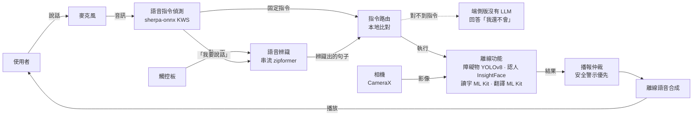
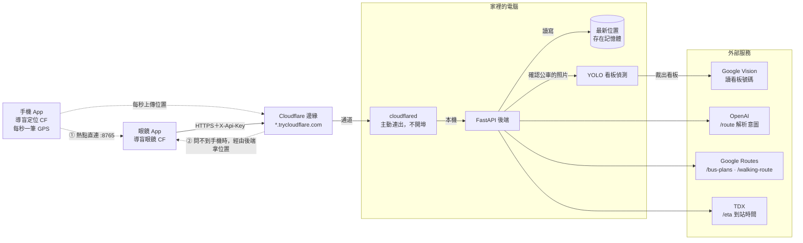
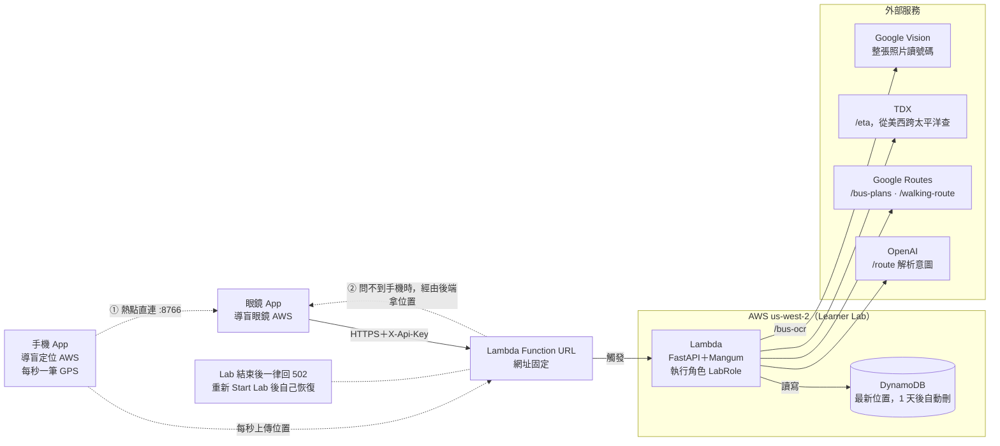
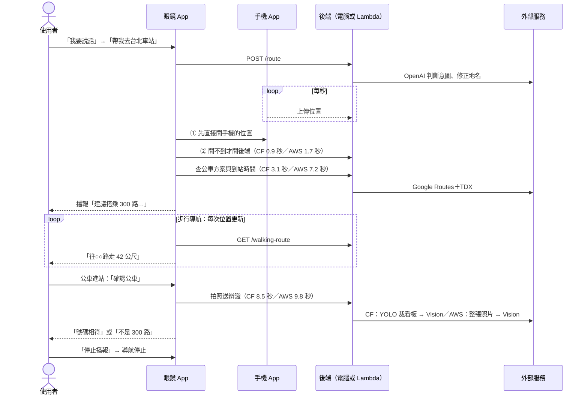

# Guide Glasses — AI 導盲眼鏡

[English](README.md) | **繁體中文**

Guide Glasses 把 **Rokid 智慧眼鏡**變成視障者的語音助理。
使用者戴上眼鏡後，不需要看螢幕，也不需要按任何按鈕，只要用說的，
眼鏡就會告訴他前方有什麼、眼前的人是誰、招牌寫什麼，並一路帶他搭上正確的公車。

> 雲端負責「想得更好」，眼鏡負責「讓人安全」。
> 障礙物偵測、人臉辨識、文字朗讀與語音都**在眼鏡上離線執行**；
> 只有需要即時資料或 LLM 的功能（公車路線、到站時間、自由發問）才會上網。

---

## 三個版本

| 版本 | 眼鏡 App | 手機 App | 後端 | 使用時要開著 | 狀態 |
|---|---|---|---|---|---|
| **端側版（地端）** | `edge/`，「導盲眼鏡」 | 無 | 無 | 只有眼鏡 | 凍結，保留作為對照 |
| **Cloudflare 版** | `apps/`，「導盲眼鏡 CF」 | 「導盲定位 CF」 | 家中電腦上的 FastAPI ＋ Cloudflare 通道 | 電腦、後端、通道 | **主力版本，已實測** |
| **AWS 版** | `apps/`，「導盲眼鏡 AWS」 | 「導盲定位 AWS」 | AWS Lambda ＋ Function URL ＋ DynamoDB | AWS Academy Learner Lab | **已部署並在眼鏡上實測** |

- 三個版本的**離線功能完全相同**，差別只在需要網路的那一半由誰處理。
- Cloudflare 版與 AWS 版的 App 是**同一份程式**（Gradle productFlavors），後端也是**同一份程式**。
- 三個版本可以同時裝在同一副眼鏡上；打開哪一版，哪一版就接管相機與麥克風，其他版本自動讓出來。

## 特點

- **全語音操作，畫面上沒有按鈕**：18 句語音指令直接說就能用，不需要喚醒詞；想自由發問就說「我要說話」，或點一下觸控板。
- **安全功能不需要網路**：障礙物偵測（YOLOv8）、人臉辨識、文字辨識、翻譯、語音辨識與語音合成，全部在眼鏡上執行。
- **完整的公車出行流程**：規劃最快的公車 → 語音一步步帶路到上車站 → 公車進站時對準車頭，核對路線號碼。
- **手機就是 GPS**：眼鏡本身沒有 GPS。眼鏡連在手機的熱點上時，直接向手機要位置；問不到才經由後端拿手機上傳的位置。
- **自然語言助理**：LLM 聽得懂「帶我去中正紀念堂」這類說法，還會修正語音辨識聽錯的台灣地名；聽不清楚的句子會請使用者再說一次。
- **為真實裝置打造**：播報音量永遠開到最大，被調小也會馬上拉回；Cloudflare 通道重開、網址變了，也不必重新建置 App。
- **重視隱私與安全**：人臉特徵只存在眼鏡上，並以 Android Keystore 保管的 AES-GCM 金鑰加密；後端沒有金鑰一律拒絕（fail-closed）；金鑰、人臉照片與定位資料都不進版控。

## 功能一覽

直接說就好，不需要喚醒詞。

| 功能 | 怎麼說 | 需要網路 |
|---|---|---|
| 停止播報（導航也一起停） | 停止播報／不要說了 | 否 |
| 偵測障礙物（一次／持續） | 前面有什麼／持續偵測前方 | 否 |
| 認人 | 這是誰／這個人是誰／前面有沒有人 | 否 |
| 讀字、讀招牌 | 上面寫什麼／唸給我聽／這是哪裡／下一段 | 否 |
| 翻譯剛讀到的字 | 翻成英文 | 否（語言包需先下載一次） |
| 查公車（預設目的地） | 查公車路線 | 是 |
| 核對進站的公車 | 確認公車 | 是 |
| 檢查狀態 | 出門前檢查 | 否 |
| 同步已登錄的人臉 | 同步人臉 | 要連到人臉註冊工具 |
| 相機自我檢測 | 測試相機 | 否 |
| 自由發問、說出目的地 | 我要說話 → 嗶一聲 → 說內容 | 是 |

說「我要說話」、聽到嗶聲之後，還可以說：

| 說法 | 做什麼 |
|---|---|
| 帶我去○○ | 用 LLM 抽出目的地，查到○○的公車並開始導航 |
| 準備翻譯 | 先下載英文語言包，之後離線也能翻譯 |
| 再說一次／上一段 | 重複剛才的播報／回到上一段文字 |
| 翻成日文 | 翻譯成其他語言 |
| 測試感測器 | 動作感測自我檢測 |
| 任何問題 | 交給 LLM 簡短回答 |

**範例：搭公車**

1. 說「我要說話」，聽到嗶一聲後說「**帶我去○○**」；或直接說「查公車路線」，前往預設目的地。
2. 眼鏡播報要搭幾路、在哪一站上車、下一班多久後到。
3. **自動開始步行導航**，用語音一步步帶到上車站。
4. 公車進站時面向車頭，說「確認公車」，眼鏡會讀出 LED 看板上的路線號碼，告訴你相不相符。
5. 說「停止播報」結束導航。

## 系統架構

### 端側版：一句話從聽到到說出，全在眼鏡上

這條流程也是 Cloudflare 版與 AWS 版的眼鏡端，那兩版只是在「指令路由」多了一條通往後端的路。



### Cloudflare 版：需要網路的請求，經通道送回家裡的電腦

家裡的電腦不開任何對外的埠，由 `cloudflared` 主動連到 Cloudflare，請求再從通道送回本機的 FastAPI。



### AWS 版：同一份後端程式，改由 Lambda 執行

和 Cloudflare 版只有中間那段不同：沒有家裡的電腦與通道，網址固定；手機位置改存 DynamoDB；確認公車不跑 YOLO。



### 一趟搭公車：請求依序經過哪裡

Cloudflare 版與 AWS 版走完全一樣的順序，差別只在「後端」是家裡的電腦還是 Lambda。秒數是實測時，眼鏡從發出請求到拿到結果的時間。



| 部分 | 負責什麼 | 技術 |
|---|---|---|
| 眼鏡 App | 語音指令、語音辨識、影像辨識、離線語音播報、導航狀態機、播報優先順序仲裁 | Kotlin、CameraX、Hilt、sherpa-onnx、ONNX Runtime、ML Kit |
| 手機 App | 每秒取得 GPS，經熱點直接傳給眼鏡，並上傳後端當備援 | Kotlin、Fused Location、前景服務 |
| 後端 | LLM 意圖解析、公車方案與到站時間、步行路線、公車車頭辨識、定位轉傳 | Python 3.12、FastAPI、OpenAI、Google Routes、TDX、Ultralytics YOLO、Google Cloud Vision；AWS 版另加 Mangum、DynamoDB |

## AI 模型

| 用途 | 模型 | 執行位置 | 授權 |
|---|---|---|---|
| 障礙物偵測（8 類：行人、汽車、機車、腳踏車、障礙物、斑馬線、導盲磚、人行道） | `obstacle_yolov8.onnx`，**團隊自行訓練**（以 YOLOv8n-seg 為基礎） | 眼鏡 | AGPL-3.0（Ultralytics） |
| 公車 LED 看板偵測 | `best.pt`，**團隊自行訓練**（Ultralytics YOLO） | 後端（只有 Cloudflare 版） | AGPL-3.0（Ultralytics） |
| 人臉特徵（512 維） | InsightFace `w600k_mbf`（MobileFaceNet、ArcFace） | 眼鏡 | 僅限非商業研究 |
| 英文語音合成 | Piper `en_US-amy-medium`（VITS） | 眼鏡 | 見模型說明 |
| 語音指令偵測 | sherpa-onnx zipformer 關鍵詞偵測模型 | 眼鏡 | 見 sherpa-onnx |
| 語音辨識（中文、串流） | `sherpa-onnx-streaming-zipformer-small-ctc-zh-int8-2025-04-01` | 眼鏡 | 見 sherpa-onnx |
| 中文語音合成 | `matcha-icefall-zh-baker` ＋ HiFi-GAN 聲碼器 | 眼鏡 | 見 sherpa-onnx |
| 人臉偵測、文字辨識、翻譯 | Google ML Kit | 眼鏡 | Google ML Kit 條款 |
| 意圖解析、聊天 | OpenAI `gpt-4o-mini` | 雲端 | OpenAI 條款 |
| 公車號碼文字辨識 | Google Cloud Vision | 雲端 | Google Cloud 條款 |

模型來源與 SHA-256 校驗碼見 [`shared/models/README.md`](shared/models/README.md)。

## 專案結構

依版本分組。標示「（不進版控）」的只存在自己的電腦上，clone 下來不會有，要自己準備。

```
guide_glasses_project_/
├── README.md                          英文說明（GitHub 首頁）
├── README.zh-TW.md                    繁體中文說明（本檔案）
├── LICENSE                            MIT
├── .gitignore · .gitattributes
│
│  ══ 端側版（地端）：只用眼鏡，不需要網路、沒有後端 ═══════════════════
│
├── edge/                              獨立的 Android 專案（凍結，= tag v1-local-only，保留作為對照）
│   ├── app/                           眼鏡 App「導盲眼鏡」（com.guideglasses）
│   ├── core/                          core-domain · core-common · core-database
│   ├── ai/                            ai-asr-offline · ai-tts-offline · ai-speech · ai-agent
│   │                                  ai-vision · ai-face · ai-ocr · ai-translate
│   ├── glasses/                       glasses-camerax · glasses-sensors
│   ├── feature/feature-assistant/
│   ├── tools/
│   ├── README.md · DOCUMENTATION.md · Gradle 設定（gradlew.bat、settings.gradle.kts…）
│   ├── local.properties               （不進版控）Android SDK 路徑
│   └── ai/ai-asr-offline/src/main/assets/kws/、zh/
│                                      （不進版控）語音指令與語音辨識模型
│
│  ══ Cloudflare 版＋AWS 版：共用同一份 Android 程式 ══════════════════
│
├── apps/
│   ├── app/                           眼鏡 App「導盲眼鏡 CF／AWS」
│   │   ├── src/main/kotlin/com/guideglasses/      兩版共用的全部程式
│   │   │   ├── MainActivity.kt                    畫面（沒有按鈕）、觸控板點一下、開發用廣播
│   │   │   ├── GuideGlassesApplication.kt         啟動時把音量開到最大、版本交接
│   │   │   ├── GuideGlassesForegroundService.kt   前景服務：相機、麥克風在背景持續運作，並鎖住音量
│   │   │   ├── SensorHandoff.kt                   三個版本輪流使用相機與麥克風
│   │   │   ├── AnnouncementVolume.kt              播報音量 15/15，導盲模式中被調小就拉回
│   │   │   └── di/
│   │   │       ├── AssistantModule.kt             功能組裝（公車預設目的地、手機直連網址等）
│   │   │       ├── CoreModule.kt                  基礎元件組裝
│   │   │       ├── ApiKeyInterceptor.kt           每個請求帶上 X-Api-Key
│   │   │       └── BackendUrlOverride.kt          執行期更換後端網址（不必重建）
│   │   ├── src/cloudflare/            CF 版專屬：只有圖示底色（橘）
│   │   ├── src/aws/                   AWS 版專屬：只有圖示底色（深藍）
│   │   └── build.gradle.kts           兩版的差別定義在這裡：名稱、套件名稱、後端網址、手機直連埠
│   ├── companion/companion-app/       手機 App「導盲定位 CF／AWS」（兩版共用）
│   │   ├── MainActivity.kt                        權限與後端網址設定畫面
│   │   ├── LocationReportService.kt               前景服務：每秒取得 GPS、上傳後端
│   │   ├── LocalLocationServer.kt                 熱點直連伺服器（CF 8765／AWS 8766）
│   │   ├── LocationHttpResponder.kt               直連伺服器的回應（要帶金鑰）
│   │   └── BackendUrlStore.kt                     手機上設定的後端網址，會同步給眼鏡
│   ├── core/
│   │   ├── core-domain/               純 Kotlin 功能邏輯，依功能分套件：
│   │   │                              assistant（語音指令、意圖路由）· announce（播報優先順序）
│   │   │                              bus（公車規劃與核對）· navigation（步行導航）· face（人臉比對）
│   │   │                              obstacle · ocr · text · translate · readiness · speech
│   │   │                              backend · glasses · motion
│   │   ├── core-common/               共用工具
│   │   └── core-database/             人臉資料庫（PersonStorage）與特徵加密（EmbeddingCipher）
│   ├── ai/
│   │   ├── ai-asr-offline/            離線語音辨識與語音指令偵測（sherpa-onnx）
│   │   ├── ai-tts-offline/            離線語音合成：中文 matcha、英文 Piper（模型在 assets/）
│   │   ├── ai-speech/                 系統語音服務（備援）
│   │   ├── ai-agent/                  LLM 意圖解析（呼叫後端 /route）
│   │   ├── ai-vision/                 障礙物偵測（團隊自訓 obstacle_yolov8.onnx）
│   │   ├── ai-face/                   人臉偵測（ML Kit）、特徵（InsightFace w600k_mbf）、照片同步
│   │   ├── ai-ocr/                    文字辨識（ML Kit）
│   │   ├── ai-translate/              翻譯（ML Kit）
│   │   └── ai-navigation/             手機定位（直連／經由後端）、公車與步行路線、車頭辨識
│   ├── glasses/
│   │   ├── glasses-camerax/           相機（CameraX）
│   │   └── glasses-sensors/           動作感測
│   ├── feature/feature-assistant/     助理的指令分派（AssistantViewModel）與提示音
│   ├── tools/
│   │   ├── face_enroll_server.py      人臉註冊工具：瀏覽器上傳照片，眼鏡來同步
│   │   ├── test_commands.ps1          語音指令偵測率測試
│   │   └── README.md
│   ├── README.md · DOCUMENTATION.md · Gradle 設定（gradlew.bat、settings.gradle.kts…）
│   ├── keystore.properties.example    共用簽章設定範本
│   ├── keystore.properties            （不進版控）共用簽章
│   ├── local.properties               （不進版控）兩版各自的後端網址與金鑰
│   └── ai/ai-asr-offline/src/main/assets/kws/、zh/
│                                      （不進版控）語音指令與語音辨識模型
│
│  ══ 後端：Cloudflare 版與 AWS 版共用同一份程式 ═══════════════════
│
├── backend/
│   ├── app/                           FastAPI
│   │   ├── main.py                    金鑰驗證、/route（LLM）、/health、/ws（目前只回聲）
│   │   ├── config.py                  設定（路徑一律以 backend/ 為準）
│   │   ├── llm.py                     OpenAI 意圖解析、修正地名、提示詞
│   │   ├── bus_logic.py               公車方案、到站時間、LED 看板 YOLO ＋ Cloud Vision
│   │   ├── navigation_logic.py        步行路線
│   │   ├── lambda_handler.py          只有 AWS 版用：Lambda 進入點（Mangum）
│   │   └── routers/
│   │       ├── bus.py                 /bus-plans · /eta · /bus-ocr
│   │       ├── location.py            /update-location · /current-location（CF 存記憶體／AWS 存 DynamoDB）
│   │       ├── navigation.py          /walking-route
│   │       └── translate.py           /translate · /latest-text
│   ├── tests/                         pytest（36 個；AWS 以 moto 在本機模擬）
│   ├── deploy/
│   │   ├── cloudflare/                Cloudflare 版部署
│   │   │   ├── start-backend.ps1      用 .venv 啟動後端（只聽 127.0.0.1）
│   │   │   ├── config.yml.example     具名通道設定範本（有網域時用）
│   │   │   └── README.md
│   │   └── aws/                       AWS 版部署
│   │       ├── build_lambda.py        打包 Lambda（不需要 Docker）
│   │       ├── deploy.py              deploy／status／destroy
│   │       └── README.md
│   ├── requirements.txt               Cloudflare 版（含 YOLO）
│   ├── requirements-lambda.txt        AWS 版（沒有 torch，所以不跑 YOLO）
│   ├── requirements-dev.txt           測試與部署工具
│   ├── .env.example                   Cloudflare 版設定範本
│   ├── .env.aws.example               AWS 版設定範本
│   ├── README.md
│   ├── .env · .env.aws                （不進版控）兩版各自的金鑰
│   ├── credentials/                   （不進版控）Google Cloud Vision 服務帳戶
│   ├── models/                        （不進版控）LED 看板的 YOLO 模型
│   ├── debug/                         （不進版控）確認公車時存下的辨識畫面
│   └── build/                         （不進版控）AWS 部署包 lambda.zip
│
│  ══ 共用的資料與文件 ═════════════════════════════════════════
│
├── shared/
│   ├── README.md
│   ├── models/                        README.md · SHA256SUMS.txt（模型母本本身不進版控）
│   └── faces/                         （不進版控）人臉註冊照片
├── docs/
│   ├── AI導盲眼鏡專題計畫書.pdf · AI導盲眼鏡專題心得.pdf · AI導盲眼鏡操作卡.pdf
│   ├── 目前進度與目標.pdf · 開源AI模型應用組佐證文件.docx
│   ├── ARCHITECTURE.md                系統架構
│   ├── DEVICE_FINDINGS.md             裝置實測紀錄（§23：連網版實測）
│   ├── PROVISIONING.md                眼鏡佈建（背景限制）
│   ├── RESTRUCTURE_NOTES.md           2026-09-29 三版重整紀錄
│   ├── DEVELOPER_GUIDE.md · TECHNICAL_NOTES.md · IMPLEMENTATION_PLAN.md
│   ├── ROADMAP.md · STATUS.md · TASKS.md · PRESENTATION.md · README.md
│   ├── proposals/                     導航整合企畫書（地端版、AWS Learner Lab 版）
│   └── archive/                       舊分支 copilot-refactor-ai-assistant 的 patch 與 bundle
└── backup/                            整理前的原始檔案，原封不動保留
    ├── github-v1-local-only/          組員原型：AI_Assistant · Audio_Navigation · Face_Recognition
    │                                  Obstacle_Recognition · Text_Recognition
    ├── apk/                           （不進版控）正式端側版的 APK
    ├── local-configs/                 （不進版控）重整前的本機設定
    └── local-faces/                   （不進版控）從組員原型移出的人臉照片
```

每個版本實際用到的資料夾：

| | 端側版 | Cloudflare 版 | AWS 版 |
|---|---|---|---|
| 眼鏡 App | `edge/` | `apps/`，建置 `cloudflareDebug` | `apps/`，建置 `awsDebug` |
| 手機 App | 沒有 | `apps/companion/`（cloudflare） | `apps/companion/`（aws） |
| 後端程式 | 沒有 | `backend/app/` | `backend/app/`＋`lambda_handler.py` |
| 部署 | — | `backend/deploy/cloudflare/` | `backend/deploy/aws/` |
| 金鑰設定 | — | `backend/.env`、`guideglasses.cloudflare.*` | `backend/.env.aws`、`guideglasses.aws.*` |

## 開始使用

### 1. 共用準備

**需要準備**

- Rokid 智慧眼鏡（Android 12）與一支 Android 手機（連網版才需要）
- Windows 電腦，裝好 **Android Studio**（內附 JDK 17 以上）與 Android SDK 36
- **Python 3.12**；Cloudflare 版另需 **cloudflared**，AWS 版另需 **AWS Academy Learner Lab** 帳號
- API 金鑰（連網版）：OpenAI、Google Maps Platform（Routes API）、TDX，以及 Google Cloud Vision 服務帳戶

**取得原始碼**

```bash
git clone https://github.com/mato1321/guide_glasses_project_.git
cd guide_glasses_project_
```

**語音模型**：語音辨識與語音指令的模型檔太大，沒有放進 Git。取得方式與校驗方法見
[`shared/models/README.md`](shared/models/README.md)，下載後放到要建置的專案底下：
`apps/ai/ai-asr-offline/src/main/assets/`、`edge/ai/ai-asr-offline/src/main/assets/`（各有 `kws/` 與 `zh/`）。

**共用簽章（選用）**：把 `apps/keystore.properties.example` 複製成 `apps/keystore.properties`，
組員都用同一把簽章，才能互相覆蓋安裝而不必先移除 App。

### 2. 端側版

```bash
cd edge
gradlew.bat assembleDebug
adb -s <眼鏡序號> install -r -g app/build/outputs/apk/debug/app-debug.apk
```

- `edge/local.properties` 只需要 `sdk.dir`。
- 端側版用這台電腦自己的 debug 簽章。眼鏡上已經有別台電腦簽的「導盲眼鏡」時，要先移除才能安裝（眼鏡上的人臉資料會一起刪掉）。
- 在眼鏡上打開「**導盲眼鏡**」。

### 3. Cloudflare 版

**3-1. 啟動後端與通道**

```bash
cd backend
py -3.12 -m venv .venv
.venv\Scripts\pip install -r requirements.txt
copy .env.example .env
```

打開 `.env` 填入各項金鑰，包括 `GUIDEGLASSES_API_KEY`（自己訂一組共用密鑰；沒填的話後端會拒絕所有請求）。接著啟動後端並開通道（兩個視窗都要一直開著）：

```bash
powershell -ExecutionPolicy Bypass -File deploy\cloudflare\start-backend.ps1 -Port 8001
```

```bash
cloudflared tunnel --url http://localhost:8001
```

用瀏覽器開 `https://<你的通道>.trycloudflare.com/health`，看到 `{"status":"ok"}` 就代表成功。
臨時通道每次重開網址都會變；要固定網址，需要自己的網域加上 Cloudflare 具名通道，見
[`backend/deploy/cloudflare/README.md`](backend/deploy/cloudflare/README.md)。

**3-2. 設定並建置 App**

建立 `apps/local.properties`（這個檔案不進版控，金鑰只會留在你的電腦）：

```properties
sdk.dir=C\:\\Users\\<你的帳號>\\AppData\\Local\\Android\\Sdk
guideglasses.cloudflare.busApiEndpoint=https://<你的通道>.trycloudflare.com
guideglasses.cloudflare.llmEndpoint=https://<你的通道>.trycloudflare.com/route
guideglasses.cloudflare.apiKey=<和 GUIDEGLASSES_API_KEY 相同>
guideglasses.cloudflare.photoEndpoint=http://127.0.0.1:8100
```

用 Android Studio 開啟 **`apps` 資料夾**（在 Build Variants 選 `cloudflareDebug`），或用指令建置：

```bash
cd apps
gradlew.bat :app:assembleCloudflareDebug :companion:companion-app:assembleCloudflareDebug
```

**3-3. 安裝**

```bash
adb -s <眼鏡序號> install -r -g app/build/outputs/apk/cloudflare/debug/app-cloudflare-debug.apk
adb -s <手機序號> install -r companion/companion-app/build/outputs/apk/cloudflare/debug/companion-app-cloudflare-debug.apk
```

小米（MIUI）手機不能用 `-g`，安裝時要在手機上按「安裝」，打開 App 後再允許**精確位置**與**通知**。
裝完接著做下面的〈第一次使用〉。

### 4. AWS 版

完整步驟與費用見 [`backend/deploy/aws/README.md`](backend/deploy/aws/README.md)，以下是重點：

1. 登入 AWS Academy → Learner Lab → **Start Lab**，把「AWS Details」裡 AWS CLI 的憑證貼到 `%USERPROFILE%\.aws\credentials`（每次開 Lab 都要重貼）。
2. 把 `backend/.env.aws.example` 複製成 `backend/.env.aws` 填入金鑰；`GUIDEGLASSES_API_KEY` 建議另外產生一把，不要和 Cloudflare 版共用。
3. 打包並部署，完成後會自動驗證，並印出 Function URL：
   ```bash
   .venv\Scripts\python deploy\aws\build_lambda.py
   ```
   ```bash
   .venv\Scripts\python deploy\aws\deploy.py deploy
   ```
4. 在 `apps/local.properties` 加上 `guideglasses.aws.busApiEndpoint`、`guideglasses.aws.llmEndpoint`（加 `/route`）、`guideglasses.aws.apiKey`、`guideglasses.aws.photoEndpoint`。
5. 建置 `:app:assembleAwsDebug :companion:companion-app:assembleAwsDebug`，安裝方式同 Cloudflare 版，App 名稱是「導盲眼鏡 AWS」「導盲定位 AWS」。

> Lab 結束後網址一律回 502；重新 Start Lab 後約十幾分鐘內會自己恢復，不必重新部署。
> 用完記得 `deploy.py destroy --yes` 刪除資源（課程結束前）。

### 5. 第一次使用（每台眼鏡、每個版本都要各做一次）

1. **解除背景限制並開啟自動校時**。背景限制**不是設一次就好**：每次安裝 App（約 11 秒後）與每次眼鏡開機，系統都會改回去，
   所以裝完等 15 秒、每次開機後都要再執行第一行（套件名稱依版本換成 `com.guideglasses`、`.cloudflare` 或 `.aws`，
   見 [`docs/DEVICE_FINDINGS.md`](docs/DEVICE_FINDINGS.md) §23.1）：
   ```bash
   adb -s <眼鏡序號> shell cmd appops set com.guideglasses.cloudflare RUN_ANY_IN_BACKGROUND allow
   ```
   ```bash
   adb -s <眼鏡序號> shell settings put global auto_time 1
   ```
2. **同步人臉**：啟動註冊工具（照片放在 `shared/faces/<姓名>/`），用 USB 讓眼鏡連到這台電腦，再對眼鏡說「同步人臉」：
   ```bash
   python apps/tools/face_enroll_server.py --dir shared/faces
   ```
   ```bash
   adb -s <眼鏡序號> reverse tcp:8100 tcp:8100
   ```
   註冊工具會讓同一個區網都連得到照片，同步完就關掉。眼鏡只存算好的特徵，不會存照片。
3. **下載翻譯語言包**：說「我要說話」→「準備翻譯」（需要網路，只要做一次）。
4. **出門前檢查**：聽到「可以出門了。認得 2 個人，英文翻譯已就緒」就準備好了。

### 6. 日常使用

1. 手機開熱點，眼鏡連上這個熱點。
2. 手機打開「**導盲定位 CF**」（或 AWS），會自動開始傳送位置。
3. 眼鏡打開「**導盲眼鏡 CF**」（或 AWS），等約 20 秒讓語音模型載入。
4. 說「出門前檢查」，聽到「可以出門了」就準備好了。

**通道網址變了？** 不必重新建置。在手機 App 的「後端網址」貼上新網址即可，眼鏡連著手機熱點時會自動同步；
否則用 `adb shell am broadcast -a com.guideglasses.cloudflare.DEBUG --es cmd SET_BACKEND --es url <新網址>` 設定。
手機和眼鏡**一定要指到同一個後端**，否則眼鏡拿不到手機上傳的位置。

## 測試

```bash
cd apps && gradlew.bat test            # 423 個單元測試
```

```bash
cd backend && .venv\Scripts\python -m pytest   # 36 個測試（AWS 在本機模擬）
```

debug 版可以用 `adb` 廣播直接觸發任何功能，不必對眼鏡說話（AWS 版把 `cloudflare` 換成 `aws`）：

```bash
adb shell am broadcast -a com.guideglasses.cloudflare.DEBUG --es cmd DETECT_OBSTACLES
```

常用的 `cmd`：`ASK --es text 你好`（把一句話當成語音辨識結果）、`SET_BACKEND --es url <網址>`、
`PLAN_BUS_ROUTE`、`CONFIRM_BUS`、`READINESS_CHECK`、`SYNC_PEOPLE`、`CAMERA_TEST`、`STOP`，完整清單見 `MainActivity.kt`。
要實測語音指令的偵測率，用 `apps/tools/test_commands.ps1`。

## 常見問題

| 狀況 | 原因與處理 |
|---|---|
| 眼鏡說「目前沒有網路」，或 Wi-Fi 顯示「連線能力受限」 | ① 眼鏡時間錯了，所有 HTTPS 憑證都會被判定無效，開啟自動校時。② 後端連不上：通道網址變了、後端沒開、AWS 的 Lab 沒開；用瀏覽器開 `/health` 檢查。剛連上網時偶爾也會這樣，隔幾秒再說一次。 |
| 螢幕一暗就沒反應、語音指令失效 | 背景限制被系統改回去了（重新安裝或重開機後都會），重新執行〈第一次使用〉第 1 步。 |
| 查公車說「拿不到定位」 | 手機 App 沒開或沒網路；手機和眼鏡指到不同的後端；室內定位較慢，最多要等 15 秒。 |
| 紀錄一直是「經由後端」，沒有「手機直連」 | 眼鏡要連在**跑「導盲定位」那支手機**的熱點上。連在別支手機的熱點時會自動改走後端，功能照常。 |
| AWS 版全部失敗、網址回 502 | Learner Lab 沒開。Start Lab 後等十幾分鐘。 |
| 兩個聲音同時講話 | 眼鏡上的端側版也在執行，用 `adb shell am force-stop com.guideglasses` 關掉。 |
| 「我要搭公車去○○」查到的不是○○ | 這句話會用預設目的地（見〈已知限制〉），改說「帶我去○○」。 |
| 聽到嗶聲之後想取消 | 點一下觸控板。聆聽中說「停止播報」沒有作用。 |
| 說了沒反應 | 講清楚、靠近一點；或點一下觸控板，聽到嗶聲再講。 |

## 已知限制

- 「我要搭公車去○○」含有「搭公車」，會被本地指令直接攔下，改用建置時設定的預設目的地，說出的○○被忽略。要指定目的地請說「帶我去○○」。
- 說「我要說話」開始聆聽後，指令偵測會暫停，這時說「停止播報」不會執行；開始聆聽時，公車方案這類播報也不會停，語音辨識可能聽到眼鏡自己的聲音。
- 背景限制在每次安裝、每次開機後都會被系統重設，目前要靠 adb 重新設定；量產需要 Device Owner 或 MDM 佈建。
- App 連不上後端時一律說「目前沒有網路」，不會記錄真正的錯誤原因。
- Cloudflare 版：臨時通道網址會變，固定網址需要網域加具名通道；家裡的電腦要一直開著。
- AWS 版：Lab 結束後不能用；Lambda 在美國西岸，查公車比 Cloudflare 版慢（實測 7.2 秒對 3.1 秒）；確認公車不跑 YOLO。
- 測試用的眼鏡上，`com.guideglasses` 目前是組員的「導盲眼鏡_0924」，語音指令被關閉，不是 `edge/` 的版本。

## 文件

- [操作卡（PDF）](docs/AI導盲眼鏡操作卡.pdf) · [專題計畫書（PDF）](docs/AI導盲眼鏡專題計畫書.pdf) · [專題心得（PDF）](docs/AI導盲眼鏡專題心得.pdf) · [目前進度與目標（PDF）](docs/目前進度與目標.pdf)
- [導航整合企畫書：地端版（PDF）](docs/proposals/導盲眼鏡_導航整合企畫書_地端版.pdf) · [AWS Learner Lab 版（PDF）](docs/proposals/導盲眼鏡_導航整合企畫書_AWS_Learner_Lab版.pdf)
- [系統架構](docs/ARCHITECTURE.md) · [裝置實測紀錄](docs/DEVICE_FINDINGS.md) · [眼鏡佈建](docs/PROVISIONING.md) · [開發者指南](docs/DEVELOPER_GUIDE.md)
- [後端說明](backend/README.md) · [Cloudflare 通道部署](backend/deploy/cloudflare/README.md) · [AWS Lambda 部署](backend/deploy/aws/README.md) · [人臉註冊工具](apps/tools/README.md)
- [2026-09-29 三版重整紀錄](docs/RESTRUCTURE_NOTES.md)

## 授權

原始碼採用 [MIT License](LICENSE)。第三方模型與函式庫依其各自的授權，
特別是 InsightFace 的模型權重僅限非商業研究使用，以 Ultralytics YOLO 訓練的模型適用 AGPL-3.0。
